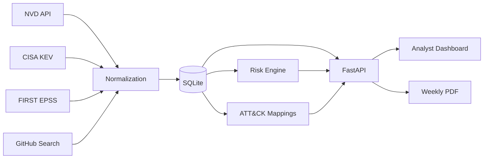

# CTI-Pulse

CTI-Pulse is a beginner-friendly Cyber Threat Intelligence aggregation and prioritization platform. It collects public CVE and exploitation signals, normalizes them into SQLite, computes an explainable risk score, maps selected records to curated MITRE ATT&CK techniques, and presents the evidence through a FastAPI dashboard and REST API.

**This project is for learning and portfolio/interview demonstration.** The PoC references and ATT&CK mappings are evidence signals; they do not prove compromise or automatically attribute technique use.

## Features

- NVD CVE collection
- CISA Known Exploited Vulnerabilities catalog enrichment
- FIRST EPSS probability and percentile enrichment
- GitHub public PoC repository discovery
- SQLite knowledge base with EPSS history
- Explainable 0-100 risk score
- Curated, analyst-reviewed ATT&CK mappings
- Searchable FastAPI dashboard
- REST API with Swagger documentation
- Weekly PDF report generation
- Repeatable demonstration seed data

## Architecture



## Risk model

CTI-Pulse uses a transparent heuristic, not an official severity standard:

`100 * (0.25 * CVSS/10 + 0.35 * EPSS + 0.25 * KEV + 0.15 * PoC)`

| Score | Priority |
|---|---|
| 80-100 | Critical |
| 60-79.9 | High |
| 40-59.9 | Medium |
| 0-39.9 | Low |

CVSS measures vulnerability severity, EPSS estimates exploitation probability, CISA KEV confirms known exploitation, and a public PoC indicates available exploit research. Each signal is retained separately in the database.

## Quick start

Windows PowerShell:

```powershell
py -3.14 -m venv .venv
.\\.venv\\Scripts\\Activate.ps1
python -m pip install -r requirements.txt
python -m app.seed
python -m uvicorn app.main:app --reload
```

Open:

- Dashboard: http://127.0.0.1:8000
- API documentation: http://127.0.0.1:8000/docs

Optional live source environment variables:

- `NVD_API_KEY`: raises NVD API limits
- `GITHUB_TOKEN`: raises GitHub API limits
- `CTI_PULSE_DB`: custom SQLite database path

## Live collection

```powershell
python -m app.cli collect
python -m app.cli collect CVE-2021-44228 CVE-2023-34362
python -m app.cli collect --no-github CVE-2021-44228
python -m app.cli report
```

GitHub API searches are also influenced by authentication and rate limits. The demo seed intentionally separates demonstrable sample records from live source collection.

## Tests

```powershell
python -m pytest -q
```

## Build guide

The detailed code walkthrough is available as [`docs/CTI-Pulse-Build-Walkthrough.pdf`](docs/CTI-Pulse-Build-Walkthrough.pdf), with its editable source in [`docs/BUILD_WALKTHROUGH.md`](docs/BUILD_WALKTHROUGH.md). Regenerate the PDF with:

```powershell
python scripts/generate_build_guide.py
```

## Repository structure

```text
app/
  collectors.py       API collection clients
  db.py               SQLite schema and connection helpers
  pipeline.py         Collection and enrichment workflow
  scoring.py          Transparent risk engine
  mitre.py            Curated ATT&CK mappings
  main.py             FastAPI API and dashboard routes
  reports.py          PDF report generation
  seed.py             Interview demonstration data
static/styles.css     Analyst dashboard styles
templates/            Jinja2 dashboard templates
tests/                Unit tests
docs/                 Technical and interview documentation
scripts/              Documentation/PDF generation tools
```

## Security and interpretation

- Store API keys in environment variables, never source control.
- The public GitHub search only discovers repository references; it does not execute PoC code.
- PoC presence does not prove in-the-wild exploitation.
- ATT&CK mappings are hypotheses tied to evidence and confidence; they are manually reviewed.
- The default risk formula is a learning heuristic. Production teams should validate thresholds against their own asset context and attack surface.

## License

MIT License.
