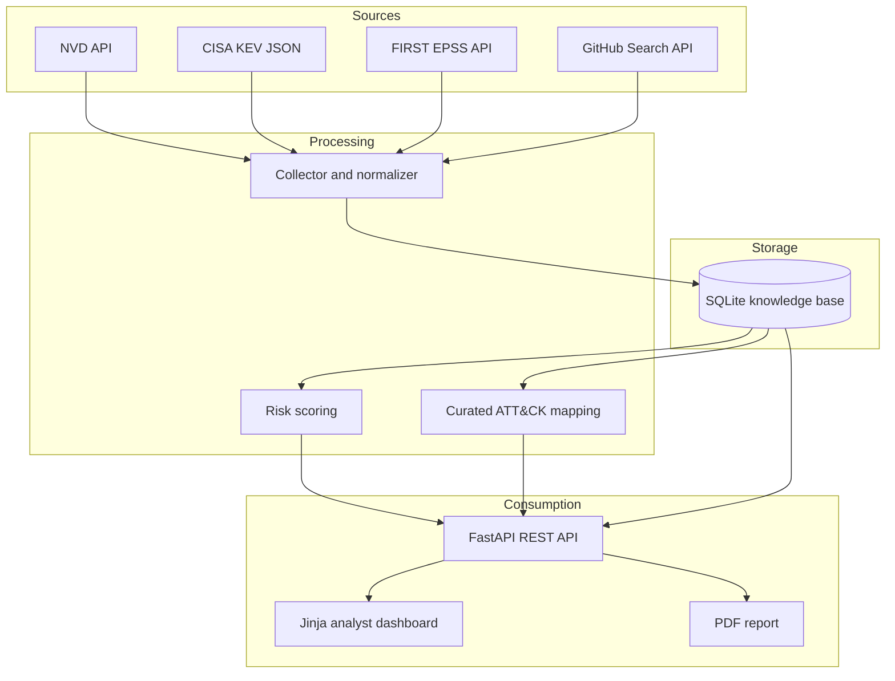
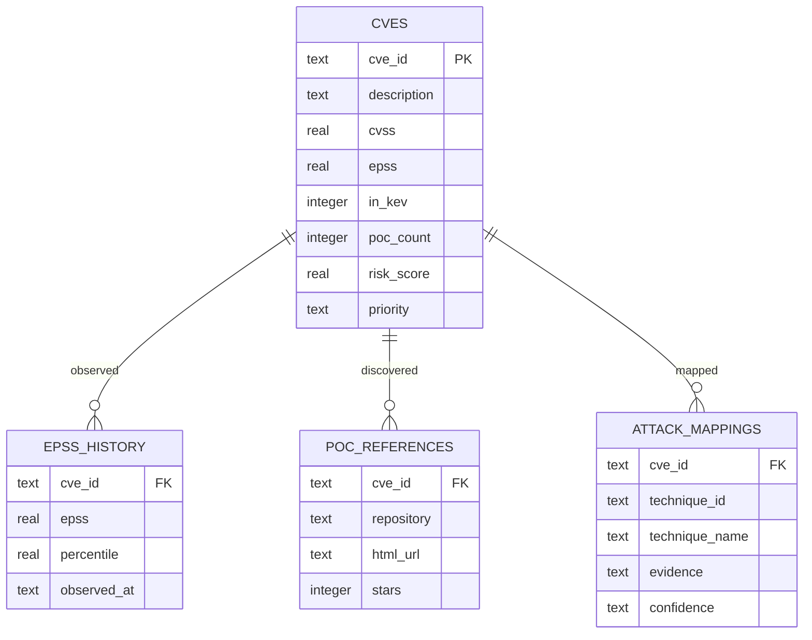

# CTI-Pulse: Technical and Conceptual Report

## 1. Executive summary

CTI-Pulse is a local cyber threat intelligence platform that collects, normalizes, correlates, prioritizes, and presents public vulnerability data. Its purpose is to help an analyst answer four practical questions: What is the vulnerability, is it likely to be exploited, is exploitation already known, and what public evidence exists?

The MVP deliberately uses Python, SQLite, FastAPI, Jinja2, and report generation. These choices minimize infrastructure while making every step inspectable.

## 2. Intelligence problem

Vulnerability feeds are incomplete when used alone:

- CVSS describes severity but not whether exploitation is occurring.
- EPSS estimates the probability of exploitation over the next 30 days.
- CISA KEV identifies vulnerabilities used in known exploitation.
- GitHub PoC references show technical exploit research or availability.
- MITRE ATT&CK describes adversary behavior, not vulnerability severity.

CTI-Pulse correlates these distinct evidence types instead of treating them as interchangeable.

## 3. System architecture

### Component responsibilities

| Component | Responsibility |
|---|---|
| Collectors | Call public APIs and convert JSON into Python dictionaries |
| Normalizer | Store all sources under a common CVE primary key |
| SQLite | Persist CVEs, source evidence, histories, PoCs, and mappings |
| Risk engine | Apply documented weights and return score plus explanation |
| ATT&CK mapping | Store analyst-reviewed technique hypotheses and evidence |
| FastAPI | Expose HTML and JSON analyst interfaces |
| Report module | Generate a weekly PDF summary |

## 4. Database design

The central `cves` table uses `cve_id` as the primary key. EPSS observations are stored in a separate history table so multiple collection runs remain auditable. PoC repositories and ATT&CK mappings use separate tables because a CVE can have multiple references and multiple techniques.

## 5. Collection workflow

1. Identify CVE identifiers.
2. Query CISA KEV and FIRST EPSS.
3. Query NVD for description, CVSS, vector, and timestamps.
4. Search GitHub for public repository evidence.
5. Normalize the values into the shared record.
6. Calculate the risk score.
7. Insert or update the SQLite record and evidence tables.
8. Record collection timestamps and run status.

Upserts prevent duplicate CVE rows. Separate detail tables prevent duplicate evidence and preserve collection history.

## 6. Risk prioritization

The formula is:

`R = 10 * (0.25C + 0.35E + 0.25K + 0.15P)`

Where `C` is CVSS/10, `E` is EPSS, `K` is the KEV binary indicator, and `P` is whether a public PoC was found. The dashboard displays the result as a 0-100 score.

The model is a heuristic built for explainability and educational use. It is not CVSS, EPSS, CISA, or MITRE's official score. A team can tune weights only after testing against its own asset and incident context.

### Risk limitations

- EPSS is a statistical estimate, not a verdict.
- KEV is an important exploitation signal but not the only exploitation evidence.
- GitHub repositories may contain analysis, duplicate content, or unusable exploit code.
- No asset inventory or exposure data is included in the MVP.
- PoC evidence does not establish that the CVE is exploited in a particular organization.

## 7. MITRE ATT&CK mapping method

CTI-Pulse uses a curated mapping file rather than claiming every CVE has a deterministic technique. For each mapping it stores technique ID, technique name, tactic, evidence, source, confidence, and review status.

ATT&CK is a behavior framework. A vulnerability is a weakness; a technique describes how an adversary could exploit or interact with a system. The mapping must therefore explain the connection and remain a hypothesis.

## 8. API

FastAPI exposes `/api/v1/cves`, `/api/v1/cves/{cve_id}`, and report endpoints. Swagger UI documents request parameters and response shapes. Jinja2 templates consume the same SQLite data for the analyst dashboard.

## 9. Testing approach

Tests cover the risk formula, threshold boundaries, SQLite schema, and future collector normalization. Live API tests use mocks or recorded fixtures rather than relying on external availability.

## 10. Ethical use

The project does not execute exploit code or interact with target systems. It searches public metadata and stores references. Analysts remain responsible for legal authorization and for validating whether a vulnerability affects their own environment.

## 11. Demonstration script

1. Seed and open the dashboard.
2. Explain the columns and source signals.
3. Filter for CISA KEV and Critical records.
4. Open a CVE detail page.
5. Show the risk breakdown and evidence limits.
6. Explain the curated ATT&CK mapping.
7. Open Swagger and query a CVE.
8. Generate a PDF and explain the collection workflow.
